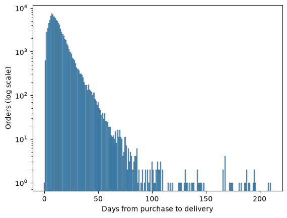
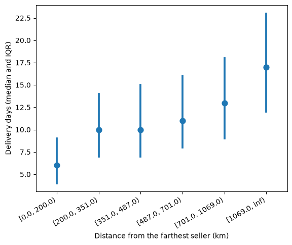
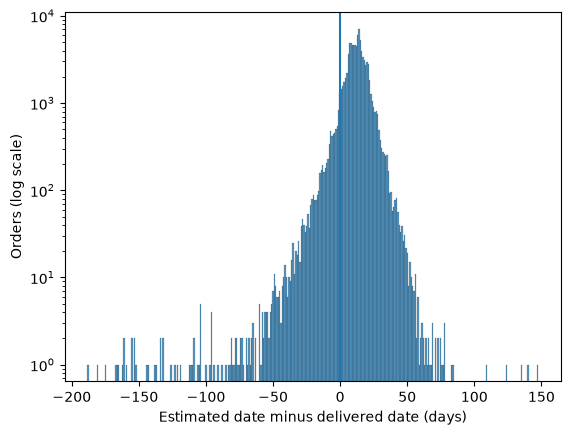
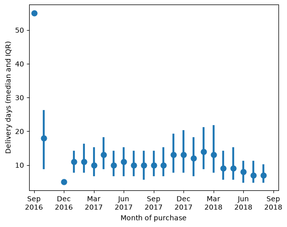

# Olist e-commerce data cleaning and EDA


A full audit, cleaning and exploratory analysis of the [Brazilian E-Commerce Public Dataset by Olist](https://www.kaggle.com/datasets/olistbr/brazilian-ecommerce), 99,441 orders placed between September 2016 and October 2018 across nine related tables.

The project is the data foundation for a machine learning service. The cleaning notebook audits every table and writes a cleaned copy without dropping a transactional row or imputing a missing value. The analysis notebook then asks five questions of the cleaned data and turns their answers into a specification for a service that gives a **delivery promise at checkout**, one that has to be kept as often as Olist's own estimate while promising fewer days.

## Table Of Contents

- [Highlights](#highlights)
- [Dataset](#dataset)
- [Repository structure](#repository-structure)
- [Getting started](#getting-started)
- [Approach](#approach)
- [Data cleaning](#data-cleaning)
- [Exploratory analysis](#exploratory-analysis)
- [Key figures](#key-figures)
- [Result, the service specification](#result-the-service-specification)
- [Limitations](#limitations)
- [Next steps](#next-steps)
- [Tech stack](#tech-stack)
- [Acknowledgements](#acknowledgements)

## Highlights

- **Nine tables audited, every loss recorded.** No row of a transactional table was dropped and no missing value was estimated. Eight changes were made, each with its reason, and 22 findings were recorded with their size instead of being corrected.
- **`geolocation` reduced from 1,000,163 rows to one point for each of 18,901 zip prefixes**, with every rule declared before the count that tests it and the state of each prefix checked against the Correios CEP ranges, a reference outside the dataset.
- **Per-customer problems ruled out.** Only 3.04% of customers buy more than once, so churn, lifetime value and recommendation have almost nothing to learn from.
- **Olist's estimate is a promise, not an expected time.** It is late for 6.77% of delivered orders and keeps 93.23% of them with 24.37 promised days on average, 2.63 days fewer than the 27 day constant promise kept as often. That makes it a real baseline rather than a straw man.
- **Distance earns its place as a feature.** Predicting each order with the median of its distance bin lowers the mean absolute error from 6.12 to 5.27 days.
- **A split in time with a measured shift.** Training uses the 75,162 orders delivered before June 2018 and testing the 18,603 orders bought from June to August 2018, which turn out to be the three fastest of the kept months.

## Dataset

The data is the public dataset Olist released on Kaggle. It is real commercial data that Olist anonymised before release. Purchases run from 4 September 2016 to 17 October 2018.

| table | rows | one row is |
|---|---:|---|
| `orders` | 99,441 | one order |
| `customers` | 99,441 | one customer record attached to an order |
| `order_items` | 112,650 | one item within an order |
| `order_payments` | 103,886 | one payment instrument used on an order |
| `order_reviews` | 99,224 | one review attached to one order |
| `products` | 32,951 | one product |
| `sellers` | 3,095 | one seller |
| `geolocation` | 1,000,163 | one point for a zip code prefix, many per prefix |
| `product_category_name_translation` | 71 | one category name in Portuguese and English |

The raw files are not part of this repository. Check the license on the [Kaggle page](https://www.kaggle.com/datasets/olistbr/brazilian-ecommerce) before reusing the data.

## Repository structure

```text
.
├── 01_data_cleaning.ipynb               audit and cleaning of the nine raw tables
├── 02_exploratory_data_analysis.ipynb   five questions that specify the ML service
├── geo.py                               haversine distance shared by both notebooks
├── images/                              figures used in this README
├── data/                                raw Olist CSV files (not tracked)
└── data_clean/                          cleaned tables as parquet (not tracked, written by 01)
```

## Getting started

The notebooks were developed and run on Python 3.14.4 with pandas 3, in VS Code.

**1. Clone the repository and create an environment**

```bash
git clone https://github.com/Spyrsial/olist-ecommerce-data-cleaning-eda.git
cd olist-ecommerce-data-cleaning-eda
python3.14 -m venv .venv
source .venv/bin/activate        # Windows: .venv\Scripts\activate
pip install pandas numpy matplotlib seaborn pyarrow jupyterlab
```

**2. Add the data**

Download the dataset from [Kaggle](https://www.kaggle.com/datasets/olistbr/brazilian-ecommerce) and place the nine CSV files in `data/` with their original names.

```text
data/
├── olist_customers_dataset.csv
├── olist_geolocation_dataset.csv
├── olist_order_items_dataset.csv
├── olist_order_payments_dataset.csv
├── olist_order_reviews_dataset.csv
├── olist_orders_dataset.csv
├── olist_products_dataset.csv
├── olist_sellers_dataset.csv
└── product_category_name_translation.csv
```

**3. Run the notebooks in order**

Run both notebooks top to bottom from the repository root, so that the relative paths and the `geo.py` import resolve.

1. `01_data_cleaning.ipynb` writes the nine cleaned tables as parquet to `data_clean/` and reads each one back to confirm it arrives as it left.
2. `02_exploratory_data_analysis.ipynb` reads `data_clean/`, checks every shape and the dtypes of the key columns against the export, and runs the analysis.

## Approach

Both notebooks follow the same rules, and most of their markdown exists to make each decision traceable.

- **Observe before acting.** Every table is understood before anything in it is changed.
- **Declare before counting.** Keys, value ranges, timestamp rules, thresholds and populations are written down before the count that tests them, so no result shapes its own rule.
- **Record rather than correct.** A value is changed only when it is known to be wrong. Everything else is recorded with its size and the reason it stays.
- **Flag rather than drop.** Orders with timestamps out of order reach the analysis as four boolean flags, not as deleted or edited rows.
- **A light pass in the analysis.** Each question gets one or two plots or counts and a short verdict, and is followed further only when a result comes out large and unexplained.

## Data cleaning

[`01_data_cleaning.ipynb`](01_data_cleaning.ipynb) works through the tables in the order a problem would surface.

| chapter | what it asks |
|---|---|
| Schema, shapes and dtypes | What each table holds before anything is touched |
| Missing values | Where they sit, whether they cluster, and what is done about each group |
| Duplicates | Whether the declared grain of each table holds |
| Referential integrity | Whether every key points at a row that exists, and which rows are never pointed at |
| Translation and geolocation coverage | Whether every category has a translation and every zip prefix in use has coordinates |
| Cross-table consistency | Whether two tables describing the same fact agree, for order value, geography, timestamps and status |
| Value ranges and typos | Whether a single value can exist on its own, against bounds, closed sets, date windows and a coordinate box |
| Monotonicity | Whether the timestamps of an order follow the order of the events they record |
| Geolocation aggregation | How to reduce `geolocation` to one point per zip prefix |
| Export and summary | Writing the cleaned tables and stating what was found, changed and left alone |

### What changed

| change | table | reason |
|---|---|---|
| Timestamps converted to datetime | `orders`, `order_items`, `order_reviews` | Every duration and date window is built on them |
| `product_category_name` filled with `unknown` | `products`, 610 rows | The rows are valid sales, and the label makes no claim about the category |
| 2 translations added | `prod_categ_name_transl` | A join on the lookup leaves only `unknown` untranslated |
| 4 weights of zero grams set to NaN | `products` | A product cannot weigh nothing |
| 4 shipping deadlines in 2020 set to NaT | `order_items` | The last order was placed in October 2018 |
| 2 column names corrected to `length` | `products` | The source misspells them |
| 4 monotonicity flags added | `orders` | The 1,382 orders reach the analysis notebook as rows, not as a count |
| Reduced to one point per zip prefix | `geolocation_by_prefix` | The only form of `geolocation` that joins without multiplying rows |

<details>
<summary><b>Found and left alone, 22 findings</b></summary>

| finding | size | why it stays |
|---|---|---|
| Products missing all four metadata fields | 610 products | Dropping them loses 1,603 item rows at join time, and imputing erases the joint missingness |
| Products missing all four physical attributes | 2 products, 18 item rows | The same mechanism as the 610 |
| Timestamps of stages never reached | 2,957 orders | NaN means the event did not happen |
| A later stage recorded while an earlier one is missing | 15 orders | No column records the missing value |
| `delivered` with no delivery date | 8 orders | Nothing separates an unrecorded delivery from a wrong status |
| Orders holding more than one review | 547 orders, 202 with differing scores | The grain of the table, not an error |
| Identical rows in `geolocation` | 261,831 rows | Every centre was computed from distinct locations instead |
| Orders with no items | 775 orders | Structural for every status except the 3 below |
| `invoiced` and `shipped` orders whose paid items are gone | 3 orders | Nothing to reconstruct them from |
| A `delivered` order with no payment | 1 order | Nothing to reconstruct it from |
| Orders with no review | 768 orders | A review is optional |
| Prefixes with no geolocation row | 278 customers, 7 sellers | The only fill is a neighbouring prefix, which the aggregation declines |
| Orders paying at least 1 BRL less than their items | 18 orders | No column holds the right figure |
| Seller prefixes contradicting `geolocation`, and carrying two states within `sellers` | 16 and 17 prefixes | Nothing reads `seller_state` |
| Reviews dated before their own order | 64 reviews | No column holds the right date |
| `canceled` orders carrying a delivery date | 6 orders | Reads as a cancellation recorded after arrival |
| Zero-value payments | 9 payments over 8 orders | 3 are `not_defined` on orders never approved and 6 are vouchers |
| Payments at zero installments | 2 payments | Nothing to correct them from |
| Zeros in `freight_value` | 383 items | Allowed by the declaration |
| Values sitting on a ceiling of the listing form | 30,000 g and 105 cm | Possibly truncated, with nothing to recover them from |
| Misspelled English category names | 5 of 73 | Olist's own lookup, left as written |
| Timestamps out of the declared order | 1,382 orders | No column says which timestamp is wrong, so the orders are flagged instead |

</details>

### Geolocation aggregation

`geolocation` holds many points per zip prefix and cannot be joined as it arrives. Each prefix is reduced to one point under rules declared before any count. Points outside Brazil's bounding box are dropped, the centre of a prefix is the per-coordinate median of its distinct locations, a point more than 150 km from that centre is treated as belonging elsewhere, and a prefix whose locations cannot produce a point within a 10 km tolerance gets no point at all. The state of each prefix is checked against the Correios CEP ranges, which found one wrong label among 18,893 single-state prefixes.

The cost is 663 of 112,650 order items, 0.59%, without a point on at least one side. Since every point stands for an area, distances built from these points are taken as reliable only from 200 km upwards.

### Carried into the analysis

The cleaning notebook ends with the rules the analysis has to respect. The most important ones are that `unknown` and `not_defined` are placeholders to exclude from any analysis by category or payment type, that the grain of `order_reviews` is the pair of `order_id` and `review_id`, that `order_status` is a final state rather than a progress indicator, and that geography comes from `geolocation_by_prefix` and never from `seller_city` or `seller_state`.

## Exploratory analysis

[`02_exploratory_data_analysis.ipynb`](02_exploratory_data_analysis.ipynb) checks that the cleaned tables arrive exactly as exported, then asks five questions. Each one settles a part of the service.

| question | what it found | what it decided |
|---|---|---|
| **Q0.** Which problem does the data support? | 2,888 of 94,990 customers, 3.04%, buy more than once. 4,794 of 96,353 reviews on delivered orders, 4.98%, are answered before delivery | Per-customer problems are closed. The review score stays open as an alternative, and delivery is the candidate the other questions test |
| **Q1.** What shape does delivery time take? | Across 96,470 delivered purchases the median is 10 days and the mean 12.5. 99% arrive within 46 days and the tail runs to 210 | The target is calendar days from purchase to delivery, with no transform and the upper tail kept |
| **Q2.** Does distance explain delivery time? | Above 200 km the median rises from 10 days in the nearest bin to 17 in the farthest, and the middle half widens. Bin medians lower the mean absolute error from 6.12 to 5.27 days | Distance from the farthest seller earns its place as a feature |
| **Q3.** How good is Olist's estimate? | It is late for 6.77% of orders. Half the orders arrive at least 12 days early. It keeps 93.23% of orders with 24.37 promised days on average, against 27 days for a constant promise kept as often | The service predicts a promise, and Olist's estimate is the bar it has to beat |
| **Q4.** How do volume and delivery time move over time? | 2016 holds too few orders, and September 2018 ends too close to the last delivery in the data. From April 2018 the median falls, reaching 7 days in July and August | A split in time over the 20 months from January 2017 to August 2018, with June to August 2018 as the test |

## Key figures

<table>
  <tr>
    <td width="50%"></td>
    <td width="50%"></td>
  </tr>
  <tr>
    <td><b>Q1.</b> Days from purchase to delivery, log scale. The median is 10 days and the tail runs to 210.</td>
    <td><b>Q2.</b> Delivery days by distance from the farthest seller. Both the median and the spread grow with distance.</td>
  </tr>
  <tr>
    <td width="50%"></td>
    <td width="50%"></td>
  </tr>
  <tr>
    <td><b>Q3.</b> Estimated date minus delivered date. Left of zero the order was late, which happens for 6.77% of orders.</td>
    <td><b>Q4.</b> Delivery days by month of purchase. The test months of June to August 2018 are the three fastest of the kept months.</td>
  </tr>
</table>

## Result, the service specification

The analysis closes with what is carried into the service.

| decided | value | from |
|---|---|---|
| Target | The days from purchase to delivery, counted between the two dates | Q1 |
| What the service predicts | A promise, since Olist's estimate is late for 6.77% of orders, far below the quarter that marks a promise | Q3 |
| Measure | How often the promise is kept and the mean days it promises, not the mean absolute error | Q3 |
| Population | The delivered purchases of the 20 kept months, January 2017 to August 2018, 96,203 orders, less those without a point | Q1, Q2, Q4 |
| Baseline | Olist's estimate, kept for 93.23% of orders with 24.37 promised days on average | Q3 |
| Bar | Keep the promise for at least as many orders as the estimate on the same orders, and promise fewer than its mean days | Q3 |
| Split | In time. Training is the 75,162 orders delivered before 1 June 2018, test is the 18,603 orders bought from June to August 2018, and 2,438 orders bought before June but delivered after it are in neither set | Q4 |
| Features | Distance from the farthest seller, with orders under 200 km as one bin of their own | Q2 |

Orders whose customer or seller has no point, 0.60% of delivered purchases, stay out of the population. At checkout their customers receive Olist's estimate, so they never get less than they get today.

## Limitations

- **Distances are approximate.** Each customer and seller is placed at one point per zip prefix rather than at an address, so distances are reliable only from 200 km upwards.
- **The late share is a lower bound.** It counts delivered orders only, and a purchase that never arrived is not counted as late.
- **The test period is faster than the training period.** The service is evaluated on months whose deliveries are faster than most of what it learns from, and the bar is measured again on those months.
- **Only one feature was tested.** Distance is the only feature the analysis measured. Every other feature is left to the service and has to be known at checkout.
- **External references are current, the data is not.** The Correios CEP ranges used to check states are the published ranges of today, while the data is from 2016 to 2018.
- **Some cleaning figures come from outside the notebook.** The reconciliation behind the 18 underpaying orders was run outside `01_data_cleaning.ipynb`, and every such figure is declared as such where it appears.
- **Reviews stop early.** `review_creation_date` ends on 31 August 2018 while purchases run to 17 October 2018.

## Next steps

- Build the delivery promise service on the specification above and evaluate it against Olist's estimate on the test months.
- Test further features that are known at checkout, under the rules the cleaning notebook carries.
- Revisit the review score, the alternative target the analysis did not rule out.

## Tech stack

Python 3.14, pandas 3, NumPy, Matplotlib, seaborn and Jupyter, developed in VS Code.

**Spiros Sialtsis** - [@Spyrsial](https://github.com/Spyrsial)